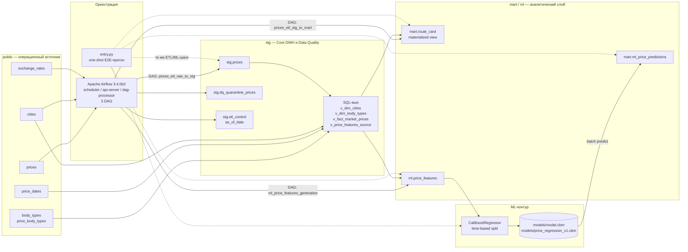

# Smart Logistics Data & ML Platform — сквозной ETL/DWH/ML-прототип для аналитики и прогнозирования тарифов грузоперевозок

Проект разворачивает локальный контур **PostgreSQL 17 + Apache Airflow + Python/CatBoost**, который проходит путь от сырых сделок `deals_bigdata` до аналитической витрины рыночного коридора ставок и таблицы пакетного ML-скоринга **«Факт vs Прогноз»**. 

## Содержание

1. [Архитектура решения и обоснование стека](#архитектура-решения-и-обоснование-стека)
   - [Схема потока данных](#схема-потока-данных)
   - [Слои и артефакты](#слои-и-артефакты)
   - [Как устроены ETL и витрины](#как-устроены-etl-и-витрины)
   - [Обоснование выбора стека](#обоснование-выбора-стека)
2. [Требования и пошаговая инструкция запуска](#требования-и-пошаговая-инструкция-запуска)
   - [Системные требования](#системные-требования)
   - [Порты](#порты)
   - [Переменные окружения (.env)](#переменные-окружения-env)
   - [Шаг 1. Запуск инфраструктуры](#шаг-1-запуск-инфраструктуры)
   - [Шаг 2. Проверка инициализации БД](#шаг-2-проверка-инициализации-бд)
   - [Шаг 3. Полный прогон ETL + ML](#шаг-3-полный-прогон-etl--ml)
   - [Шаг 4. Работа через Airflow](#шаг-4-работа-через-airflow)
   - [Шаг 5. Повторный запуск и Backfill](#шаг-5-повторный-запуск-и-backfill)
   - [Шаг 6. Остановка и полный сброс](#шаг-6-остановка-и-полный-сброс)
3. [Просмотр витрин (SQL)](#просмотр-витрин-sql)
   - [1. Наличие витрин и объём данных](#1-наличие-витрин-и-объём-данных)
   - [2. Витрина `mart.route_card`](#2-витрина-martroute_card)
   - [3. Витрина `mart.ml_price_predictions`](#3-витрина-martml_price_predictions)
4. [Сводка метрик ML](#сводка-метрик-ml)
   - [Итоговая таблица качества](#итоговая-таблица-качества)
   - [Как читать метрики](#как-читать-метрики)
   - [Условия эксперимента](#условия-эксперимента)
   - [Фактический вывод пайплайна обучения](#фактический-вывод-пайплайна-обучения)

## Архитектура решения и обоснование стека

### Схема потока данных



Поток состоит из пяти воспроизводимых шагов:

1. **Raw → STG.** Чтение `public.prices` за окно `loading_date`, конвертация валют в RUB, DQ-валидация, обогащение категорий и идемпотентная загрузка в `stg.prices` / `stg.dq_quarantine_prices`.
2. **STG → Mart.** Пересчёт материализованного представления `mart.route_card` с рыночным коридором, динамикой и Data Trust.
3. **Feature Engineering.** Расчёт календарных и циклических признаков и загрузка в `ml.price_features`.
4. **Model Training.** Хронологическое разделение `train/test`, обучение `CatBoostRegressor`, сохранение модели в `models/price_regression_v1.cbm` (в `docker-compose.yaml` путь передан как `models/model.cbm`).
5. **Batch Prediction.** Скоринг тестового периода и будущих заявок с записью в `mart.ml_price_predictions`.

### Слои и артефакты

| Слой | Объекты | Назначение |
| :--- | :--- | :--- |
| **Source** | `public.prices`, `public.cities`, `public.body_types`, `public.price_body_types`, `public.price_dates`, `public.exchange_rates` | Эталонная операционная схема и детерминированный synthetic-датасет из `sql/01_schema.sql` и `sql/02_synthetic.sql`. |
| **Core / DQ** | `stg.prices`, `stg.dq_quarantine_prices`, `stg.etl_control` | Очищенные сделки, карантин с кодом причины и указатель `as_of_date` для витрин. |
| **Справочные вьюхи** | `stg.v_dim_cities`, `stg.v_dim_body_types`, `stg.v_fact_market_prices`, `stg.v_price_features_source` | Дедупликация измерений, унификация кузовов, единая фактовая выборка для витрины и ML. |
| **Mart** | `mart.route_card` | Витрина `месяц × город отправления × город назначения × группа кузова × весовая категория` с `P25/P50/P75`, `руб./км`, `trips_count`, `carriers_count`, `cv_rate`, `mom_pct`, `yoy_pct`, `reliability_level`. |
| **ML** | `ml.price_features`, `mart.ml_price_predictions`, `models/price_regression_v1.cbm` | Признаковое пространство, результаты batch-скоринга и сериализованная модель CatBoost. |

### Ключевые файлы проекта:

```text
.
├── docker-compose.yaml          # PostgreSQL 17 + Airflow + pipeline runner
├── entry.py                     # one-shot оркестратор ETL + ML
├── sql/
│   ├── 00-create-airflow-user.sql
│   ├── 01_schema.sql            # операционная схема public
│   ├── 02_synthetic.sql         # детерминированные данные, as_of = 2026-10-26
│   ├── 03_stg_schema.sql        # stg, DQ-карантин, справочные вьюхи
│   ├── 04_mart_schema.sql       # mart.route_card
│   └── 05_ml_schema.sql         # ml.price_features, mart.ml_price_predictions
├── etl/
│   ├── prices_raw_to_stg.py     # DQ, валюты, идемпотентная загрузка
│   └── prices_stg_to_mart.py    # REFRESH MATERIALIZED VIEW
├── ml/
│   ├── features_stg_to_ml.py    # календарные и циклические признаки
│   ├── train.py                 # Time-Based Split + CatBoost
│   ├── predict_fixed.py         # Batch Inference (используется entry.py)
│   └── predict.py               # альтернативная версия Batch Inference
├── dags/                        # 3 Airflow DAG (бонусный контур)
├── utils/                       # подключение, валидация, callbacks, defaults
└── models/                      # сохранённая модель .cbm
```

### Как устроены ETL и витрины

**`etl/prices_raw_to_stg.py`** читает `public.prices` за окно `start_date` `end_date` (или CSV), подтягивает справочник городов и курсы ЦБ. Валюта `840`/`978` приводится к RUB по точному совпадению `(currency_code, nearest_rate_date)`. Затем применяются DQ-правила:

- `INVALID_PRICE` — `price <= 0`, а для RUB также `price <= 1000`;
- `INVALID_DISTANCE` — `distance <= 0`;
- `INVALID_WEIGHT` / `INVALID_VOLUME` — отрицательные вес или объём;
- `INVALID_CITY` — города нет в `cities`;
- `MISSING_RATE` — для валютной строки не найден точный курс.
Заполняются `weight_category` (`G20T`, `FTL`, `10T`, `5T`, `L5T`, `OTH` по весу с округлением до 0.1 т) и `volume_category` (`FTL` при `0 < V <= 120 м³`, иначе `OTH`).

Отклонённые строки пишутся в `stg.dq_quarantine_prices` с `dq_reject_reason`.

Повторный запуск за тот же период в рамках одной транзауции удаляет данные за период из таблицы и пишет новые

**`etl/prices_stg_to_mart.py`** обновляет материализованное представление `mart.route_card` через `REFRESH MATERIALIZED VIEW`.

**`ml/features_stg_to_ml.py`** читает `stg.v_price_features_source` и рассчитывает календарные признаки и гармонические для месяца, дня недели и дня года.
Повторный запуск за тот же период в рамках одной транзауции удаляет данные за период из таблицы и пишет новые

### Обоснование выбора стека

Почему PostgreSQL 17
Для датасета в 300 000 строк нет большой разницы в производительности. Так как сырые данные уже предлагается держать в postgres - слои очищенных данных и витрины было решено также держать в postgres. По мере роста количества данных есть смысл рассматривать переход на greenplum/clickhouse или hdfs.

Почему Apache Airflow
Оркестратор с графическим интерфейсом, логом запусков, отслеживанием расписания. Если etl-пайплайн предполагается запускать по расписанию - настраивается через DAG. 

Почему CatBoostRegressor
один из предложеныых в ТЗ фреймворков, не нужна векторизация текстовых колонок(идет из коробки)


## Требования и пошаговая инструкция запуска

### Системные требования

| Компонент | Минимум | Рекомендуется |
| :--- | :--- | :--- |
| Docker Engine / Docker Desktop | 24+ с Compose v2 | Docker Desktop 4.30+ |
| ОС | Linux, macOS, Windows с WSL2 | Windows 11 + WSL2 / Ubuntu 22.04+ |
| RAM | 8 ГБ | 16 ГБ (Airflow + PostgreSQL + CatBoost) |
| CPU | 2 vCPU | 4 vCPU |
| Диск | 10 ГБ свободно | 20 ГБ (образы, БД, модель, логи) |
| Сеть | доступ к Docker Hub | стабильный интернет для первой сборки |
| Свободные порты | `5433`, `8081` | — |

Весь код выполняется внутри контейнеров. Для локальной отладки нужен Python 3.14+ и пакеты из `python_image/requirements.txt`.

### Порты

| Сервис | Хост | Контейнер | Назначение |
| :--- | :---: | :---: | :--- |
| PostgreSQL 17 | `5433` | `5432` | Основная БД `deals_bigdata` |
| Apache Airflow UI / API | `8081` | `8080` | Веб-интерфейс и REST API Airflow |

Внутри Docker-сети PostgreSQL доступен как `postgres:5432`; именно этот адрес используется в `entry.py` и DAG-подключениях.

### Переменные окружения (.env)

Файл `.env` лежит в корне проекта и подключается ко всем сервисам через `env_file`. Для локального теста значения уже вписаны.


| Переменная | Зачем нужна |
| :--- | :--- |
| `POSTGRES_USER`,`POSTGRES_PASSWORD` | Пароль и пользователь бд postgres;
| `AIRFLOW_ADMIN_*` | Создание администратора Airflow при `airflow-init`. |
| `AIRFLOW_DB_*` | Параметры служебной БД Airflow. |
| `AIRFLOW__DATABASE__SQL_ALCHEMY_CONN` | Готовая строка подключения Airflow к PostgreSQL. |
| `AIRFLOW__API_AUTH__JWT_SECRET`, `AIRFLOW__CORE__FERNET_KEY`, `AIRFLOW__API__SECRET_KEY` | Секреты Airflow; для локального запуска можно оставить тестовые. |

### Шаг 1. Запуск инфраструктуры

Из корня проекта:

```bash
docker compose up -d --build
```

Если используется старая установка Compose, команда может называться `docker-compose up -d --build`. Первый запуск занимает **2–5 минут**: собираются образы, PostgreSQL применяет скрипты из `sql/` (включая генерацию 300 000 сделок), Airflow выполняет `airflow db migrate` и создаёт администратора.

Проверить состояние контейнеров:

```bash
docker compose ps
```

Ожидаемые сервисы: `de_postgres` (healthy), `de_airflow-init` (exited 0), `de_airflow-api-server`, `de_airflow-dag-processor`, `de_airflow-scheduler`, `de_pipeline_runner`.

Посмотреть логи инициализации PostgreSQL:

```bash
docker compose logs -f postgres
```

### Шаг 2. Проверка инициализации БД

```bash
docker exec -it de_postgres psql -U postgres -d deals_bigdata -c "SELECT count(*) AS raw_prices FROM public.prices;"
```

```bash
docker exec -it de_postgres psql -U postgres -d deals_bigdata -c "SELECT nspname FROM pg_namespace WHERE nspname IN ('stg','mart','ml') ORDER BY 1;"
```

Если база уже инициализирована, повторный `docker compose up` **не перезапускает** SQL-скрипты из `docker-entrypoint-initdb.d` — это стандартное поведение PostgreSQL. Для чистого перезапуска удалите volume (см. шаг 6).

### Шаг 3. Полный прогон ETL + ML

`runner` запускает `entry.py`с параметрами и последовательно выполняет пять шагов: Raw → STG, STG → Mart, Feature Engineering, Training, Batch Prediction. Запускается вместе со стартом кластера, отдельный вызов не требуется

Пояснения:

- `--provider sql` обязателен; значение по умолчанию `sql`
- Начало `2023-06-01` загружает всю историю synthetic-датасета, чтобы в `mart.route_card` были доступны `MoM` и `YoY`. Если нужен только ML-контур, можно начать с `2026-07-26`, но тогда `YoY` в витрине будет `NULL`.
- Конец `2026-10-26` — это `as_of`; он же становится `stg.etl_control.as_of_date` и датой среза для `train/test`.
- В конце обучения в лог выводятся метрики и сохраняется модель `models/model.cbm`.

Проверить, что прогнозы появились:

```bash
docker exec -it de_postgres psql -U postgres -d deals_bigdata -c "SELECT count(*) AS predictions, count(*) FILTER (WHERE actual_price_rub IS NOT NULL) AS with_actual, count(*) FILTER (WHERE actual_price_rub IS NULL) AS future FROM mart.ml_price_predictions;"
```

### Шаг 4. Работа через Airflow

Airflow UI доступен по адресу:

```text
http://localhost:8081
```

Логин и пароль — из `.env` (`AIRFLOW_ADMIN_USERNAME` / `AIRFLOW_ADMIN_PASSWORD`). DAG-и используют PostgreSQL Connection с идентификатором `my_postgres_db_conn`; его нужно создать один раз.
Через интерфейс Администрирование - Соединения:
  - ID соединения: `my_postgres_db_conn`
  - Тип соединения: `Postgres`
  - Хост: `postgres`
  - Логин: `postgres`
  - Пароль: `****` 
  - Порт: `5432`
  - Database: `deals_bigdata`

Через CLI:

```bash
docker exec -it de_airflow-api-server airflow connections add my_postgres_db_conn --conn-type postgres --conn-host postgres --conn-schema deals_bigdata --conn-login postgres --conn-password test --conn-port 5432
```

Порядок запуска DAG-ов:

1. `prices_etl_raw_to_stg` — загрузка и очистка (params: `date_from_iso`, `date_to_iso`, `data_provider=sql`).
2. `prices_etl_stg_to_mart` — обновление `mart.route_card`.
3. `ml_price_features_generation` — генерация `ml.price_features` (params: `start_date`, `end_date`).


Обучение и batch scoring в Airflow-контур не включены

### Шаг 5. Повторный запуск и Backfill

Повторный запуск за тот же период безопасен для ETL и признаков: `stg.prices`, `stg.dq_quarantine_prices` и `ml.price_features` перезаписываются через `DELETE + INSERT` в транзакции, а `mart.route_card` обновляется атомарно. `mart.ml_price_predictions` перед вставкой очищается по `loading_date >= as_of`, поэтому batch scoring также идемпотентен.

### Шаг 6. Остановка и полный сброс

Остановить контейнеры, сохранив данные:

```bash
docker compose down
```

Остановить и удалить volume PostgreSQL (полный сброс схемы и данных):

```bash
docker compose down -v
```

После `down -v` следующий `docker compose up -d --build` заново применит `sql/00...sql`–`sql/05...sql` и пересоздаст `deals_bigdata`.

## Просмотр витрин (SQL)

Все запросы ниже выполняются в БД `deals_bigdata`. Удобнее открыть интерактивный `psql`:

```bash
docker exec -it de_postgres psql -U postgres -d deals_bigdata
```

Дальше можно вставлять блоки целиком.

### 1. Наличие витрин и объём данных

Посмотреть, какие объекты созданы, и их тип:

```sql
SELECT
    n.nspname AS schema_name,
    c.relname AS object_name,
    CASE c.relkind
        WHEN 'm' THEN 'materialized view'
        WHEN 'r' THEN 'table'
    END AS object_type
FROM pg_class c
JOIN pg_namespace n ON n.oid = c.relnamespace
WHERE n.nspname = 'mart'
  AND c.relname IN ('route_card', 'ml_price_predictions')
ORDER BY 1, 2;
```

Количество строк в витринах:

```sql
SELECT 'mart.route_card' AS table_name, count(*) AS row_count FROM mart.route_card
UNION ALL
SELECT 'mart.ml_price_predictions', count(*) FROM mart.ml_price_predictions;
```

### 2. Витрина `mart.route_card`

Структура витрины — какие поля и типы данных в ней хранятся:

```sql
SELECT
    a.attname AS column_name,
    format_type(a.atttypid, a.atttypmod) AS data_type
FROM pg_attribute a
JOIN pg_class c ON c.oid = a.attrelid
JOIN pg_namespace n ON n.oid = c.relnamespace
WHERE n.nspname = 'mart'
  AND c.relname = 'route_card'
  AND a.attnum > 0
  AND NOT a.attisdropped
ORDER BY a.attnum;
```

Пример данных:

```sql
SELECT *
FROM mart.route_card
ORDER BY loading_month DESC
LIMIT 10;
```

### 3. Витрина `mart.ml_price_predictions`

Структура витрины:

```sql
SELECT
    a.attname AS column_name,
    format_type(a.atttypid, a.atttypmod) AS data_type
FROM pg_attribute a
JOIN pg_class c ON c.oid = a.attrelid
JOIN pg_namespace n ON n.oid = c.relnamespace
WHERE n.nspname = 'mart'
  AND c.relname = 'ml_price_predictions'
  AND a.attnum > 0
  AND NOT a.attisdropped
ORDER BY a.attnum;
```

Пример данных:

```sql
SELECT *
FROM mart.ml_price_predictions
ORDER BY loading_date DESC
LIMIT 10;
```

Пример исторических сделок с фактической ценой и прогнозом:

```sql
SELECT
    loading_date,
    loading_city_gcid,
    unloading_city_gcid,
    body_group,
    actual_price_rub,
    predicted_price_rub,
    abs_error_rub,
    ape_pct
FROM mart.ml_price_predictions
WHERE actual_price_rub IS NOT NULL
ORDER BY loading_date DESC
LIMIT 10;
```

Пример будущих заявок, для которых заполнен только прогноз:

```sql
SELECT
    loading_date,
    loading_city_gcid,
    unloading_city_gcid,
    body_group,
    actual_price_rub,
    predicted_price_rub,
    abs_error_rub,
    ape_pct
FROM mart.ml_price_predictions
WHERE actual_price_rub IS NULL
ORDER BY loading_date
LIMIT 10;
```

## Сводка метрик ML

### Итоговая таблица качества

Модель `CatBoostRegressor` обучена на исторических завершённых перевозках. Метрики ниже получены на отложенной тестовой выборке `2026-10-05 … 2026-10-26` (граница `2026-10-05` входит только в тест).

| Метрика | Значение | Что показывает |
| :--- | ---: | :--- |
| **$R^2$** | **0.9226** | Модель объясняет **92.26%** дисперсии фактического тарифа по маршрутной сети. |
| **MAPE** | **15.33%** | Средняя относительная ошибка прогноза; удобна для сравнения коротких и дальних маршрутов. |
| **RMSE** | **53 332.83 ₽** | Квадратичная ошибка в рублях; сильнее штрафует крупные промахи на дорогих и дальних рейсах. |
| **MAE** | **27 606.56 ₽** | Средняя абсолютная ошибка в рублях на один рейс; наиболее «физичная» бизнес-метрика. |

Дополнительно: ранняя остановка выбрала **296 итераций** из 1500; модель сохранена в `models/model.cbm`.

### Условия эксперимента

| Параметр | Значение |
| :--- | :--- |
| Дата среза `as_of` | `2026-10-26` |
| Train | `[2026-07-26, 2026-10-05)` |
| Test | `[2026-10-05, 2026-10-26]` |
| Валидация | Time-Based Split, без `shuffle` |
| Модель | `CatBoostRegressor` |
| Гиперпараметры | `iterations=1500`, `learning_rate=0.05`, `depth=6`, `loss_function='RMSE'`, `eval_metric='MAE'`, `random_seed=42`, `early_stopping_rounds=100` |
| Лучшая итерация | `296` |
| Целевая переменная | `price_rub` — ставка за рейс в RUB без НДС |
| Категориальные признаки | `loading_city`, `loading_region`, `unloading_city`, `unloading_region`, `body_group`, `weight_category`, `volume_category` |
| Числовые признаки | `distance`, `total_weight`, `total_volume`, координаты, год, месяц, день недели, день года и их `sin/cos`-кодирование |
| Исключённые утечки | `price_with_vat`, производные `price/distance` и `price/weight`, `carrier_cost`, `profit`, `price_group_id`, `avg_price`, `min_km_price`, `max_km_price`, `outlier_mark` |


